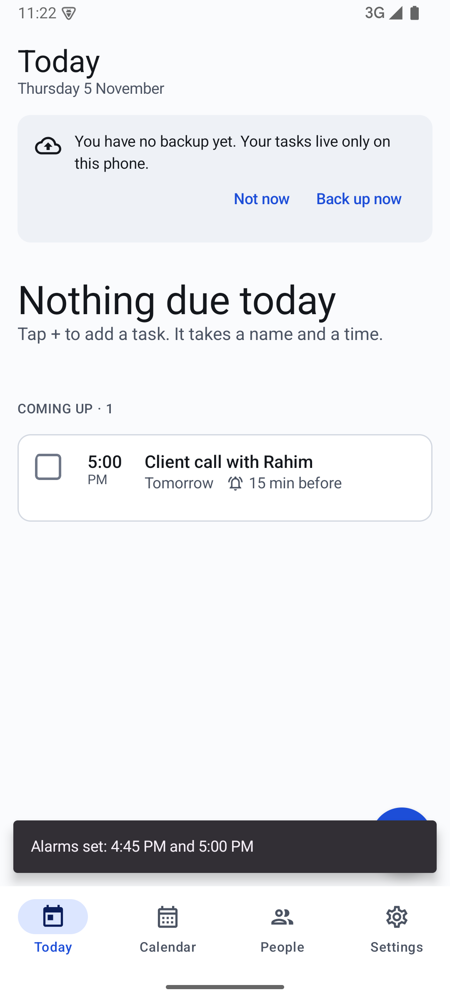
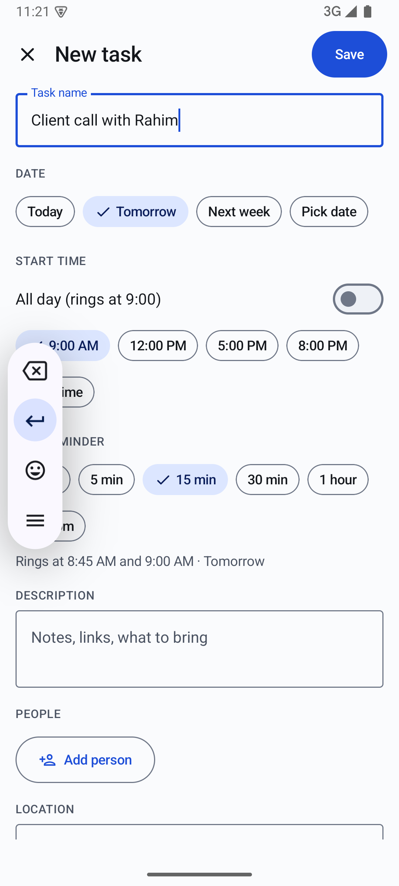
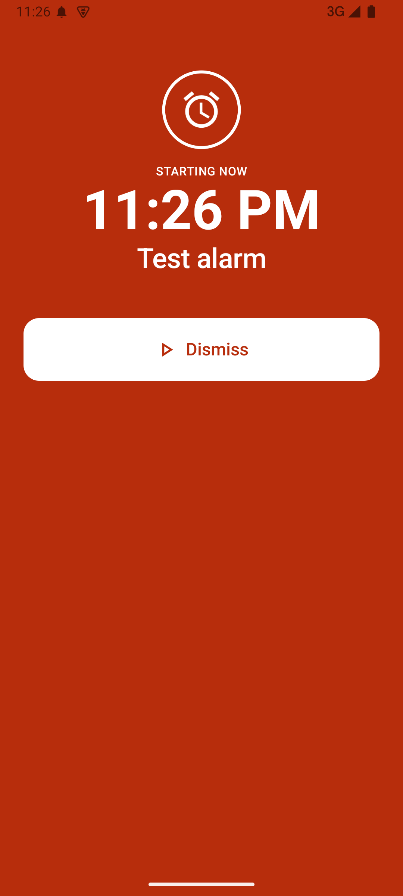
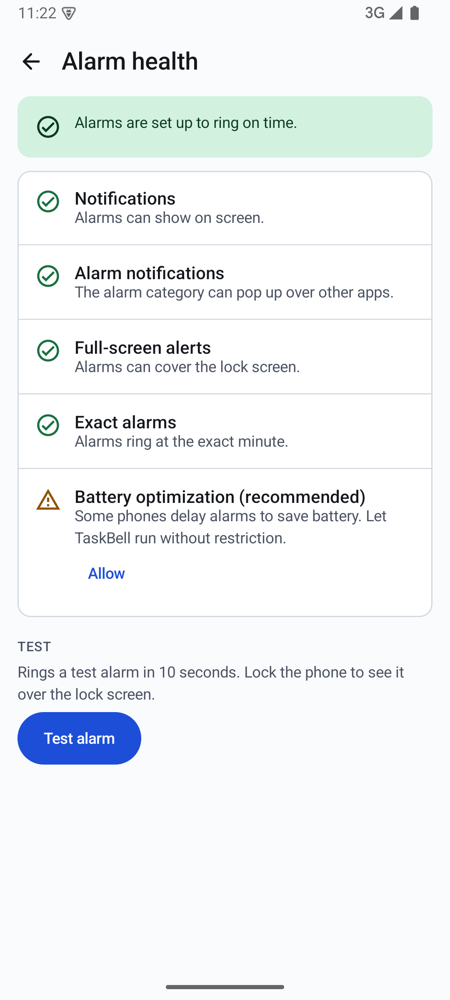

<div align="center">


# TaskBell

**Never miss the start.**

A private task manager for Android that rings twice for every task:
a gentle pre-reminder before it, and a loud alarm when it starts.

<a href="https://github.com/abdullah-al-faahim/TaskBell-releases/releases/latest/download/TaskBell.apk">
  
</a>

<sub>Android 8.0 or newer &nbsp;·&nbsp; Auto backup &nbsp;·&nbsp; Free</sub>

<br>

[Website](https://abdullah-al-faahim.github.io/TaskBell-releases/) &nbsp;·&nbsp;
[All releases](https://github.com/abdullah-al-faahim/TaskBell-releases/releases) &nbsp;·&nbsp;
[Install help](#install)

</div>

<br>

<table align="center">
  <tr>
    <td align="center"><br><sub><b>Today</b><br>Everything due, in order</sub></td>
    <td align="center"><br><sub><b>Quick entry</b><br>Name, time, save</sub></td>
    <td align="center"><br><sub><b>Start alarm</b><br>Covers the lock screen</sub></td>
    <td align="center"><br><sub><b>Alarm health</b><br>Checks your phone's settings</sub></td>
  </tr>
</table>

## What it does

| | |
|---|---|
| **Two alarms per task** | A pre-reminder at the lead time you pick (5 min to 1 day, or custom), and a start alarm that covers the lock screen and rings even in silent mode. |
| **Quick entry** | Type a name, tap a time, save. You see "Alarms set: 4:45 PM and 5:00 PM". |
| **Everything in one place** | Description with links, checklist, files and photos, people with Call, SMS, WhatsApp and Email buttons, and a Google Maps link or address with Navigate. |
| **Your way** | Categories, priority (High and Urgent keep ringing until you answer), repeat, alarm sound, vibration and snooze per task. |
| **Reliable** | Alarms survive restarts, app updates and time-zone changes. Missed alarms go to a Missed list. |
| **Backup you control** | One `.tbk` file saved to a folder you pick, with a preview before restoring. Turn on automatic backup daily, weekly or monthly; it replaces one file so old backups never pile up. |
| **Updates in the app** | TaskBell tells you when a new version is out and installs it for you. Your tasks and alarms stay. |

## Privacy

TaskBell has no account, no ads and no analytics. **Your tasks never leave the phone** unless you save a backup
file yourself. Android cloud backup is turned off for the app.

The only internet use is a once-a-day check of this repository's latest release, so the app can offer updates.
No task data is sent. You can turn it off in **Settings > About and updates**.

## Install

1. On your Android phone, tap **Download APK** above.
2. Open the downloaded file. If asked, allow your browser or file manager to install apps.
3. Follow the three setup steps, then ring the test alarm.

Uninstalling the app deletes its data. Make a backup first (Settings > Backup and restore).

### Phones that stop background apps

On Xiaomi, Oppo, Realme, Vivo, Samsung and Huawei phones, open **Settings > Alarm health** in TaskBell. It shows
the steps for your phone so alarms ring on time.

## Verify the download

Release APKs are signed with this certificate:

```
SHA-256: 3684c5360f30def918c14da9e1dbcbf5fd88ade7f3b2493e9eb935f0bb0dac91
```

Each release lists the SHA-256 of the APK file.
